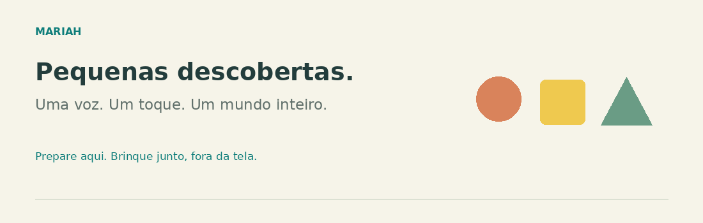
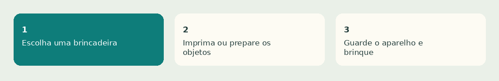

<div align="center">



# Mariah · Pequenas descobertas

**Um projeto de tio para sobrinha. Uma ponte entre preparar aqui e brincar juntos no mundo real.**

[Explorar a plataforma](https://brunnojob.github.io/Mariah-Interatividade/) · [20 desenhos para imprimir](docs/desenhos) · [Ideias e sugestões](https://github.com/brunnojob/Mariah-Interatividade/issues)

</div>

Criado com afeto para a Mariah, aos 6 meses, este espaço ajuda **pais e cuidadores** a preparar brincadeiras sensoriais, motoras e de vínculo para bebês de **6 a 12 meses**. A interação principal acontece com pessoas e objetos reais. O site é uma ferramenta para o adulto, com uma área de experiências interativas mediadas. Essas experiências não representam recomendação de tempo de tela para bebês.



## O que tem aqui

| Espaço | O que o cuidador pode fazer |
| --- | --- |
| Brincar juntos | Escolher 32 atividades por mês, dos 6 aos 12 meses, com materiais, passos, cuidados e sinais de pausa. |
| Números 1–10 | Preparar cartões visuais, ouvir nomes em português e imprimir para colorir. |
| Alfabeto A–Z | Nomear letras e palavras, ouvir um exemplo e imprimir cartões ou a folha completa. |
| Formas e cores | Explorar círculo, quadrado, triângulo, retângulo e seis cores com exemplos do mundo real. |
| Ateliê de papel | Imprimir 20 desenhos vetoriais originais, um por folha A4, ou baixar SVGs individualmente. |
| Explorar aqui | Bichinhos ilustrados, piano de cores, cucu, história de três páginas e pintura por toque com impressão. |
| Trilha mensal | Selecionar cada mesversário de 6 a 12 meses e imprimir as propostas daquele mês. |
| Cantigas | Seis músicas originais, melodias locais, versos interativos, volume e letras para cantar e imprimir. |
| Calendário | Uma proposta distinta por dia do mês, com 31 ideias e adaptações de 6 a 12 meses; aniversário opcional calculado só na página. |
| Fora da tela | Interromper o áudio, exibir a orientação escolhida e convidar o adulto a guardar o aparelho. |

<details>
<summary><strong>As 11 brincadeiras</strong></summary>

- **Sensorial:** cesto dos tesouros; cucu; bolhas de sabão; exploração de texturas na refeição, conforme orientação profissional.
- **Movimento:** brinquedos próximos na diagonal com apoio; bateria de potes; tummy time supervisionado; passagem de mão em mão.
- **Linguagem e vínculo:** leitura com entonação; dança suave no colo; imitação e conversa de ida e volta.

Além das 11 propostas iniciais, há **21 novas brincadeiras**, três para cada mês. São 32 ao todo. A idade organiza as sugestões e não funciona como prazo, diagnóstico ou pré-requisito. Todos os meses ficam acessíveis, sem pontuação ou bloqueio.

Cada proposta pode ser impressa separadamente. O guia completo inclui todas as atividades.

</details>

<details>
<summary><strong>Os 20 desenhos</strong></summary>

Sol, lua, estrela, nuvem, arco-íris, flor, árvore, maçã, pera, banana, bola, pipa, barco, casa, peixe, borboleta, caracol, urso, coelho e tartaruga. Traços grandes e espaços amplos para o adulto colorir e contar histórias. Alfabeto e números são materiais adicionais, além desses 20 desenhos.

</details>

## Brincadeira adequada à idade

**Não é um aplicativo para o bebê ficar olhando ou tocando na tela.** A [OMS](https://www.who.int/news/item/24-04-2019-to-grow-up-healthy-children-need-to-sit-less-and-play-more) recomenda evitar tempo de tela para menores de 1 ano; aos 1 ano, tempo sedentário de tela também não é recomendado. Prepare uma atividade, imprima quando útil e guarde ou bloqueie o dispositivo. O botão “Fora da tela” não bloqueia o aparelho automaticamente.

- Letras, números e cores são repertório para conversas do adulto; **não são metas de alfabetização ou contagem nessa idade**.
- Desenhos servem para o adulto colorir, apontar e narrar. Pintar não é uma habilidade esperada entre 6 e 12 meses; mantenha papel e materiais fora da boca.
- Comece com poucos instantes. **10–15 minutos não são uma meta nem uma prescrição.** Pause ao primeiro sinal de cansaço ou desinteresse.
- Adulto atento durante toda a brincadeira. Objetos grandes, íntegros e adequados à idade, sem cordões ou peças pequenas. Tummy time só acordada e supervisionada; para dormir, de barriga para cima.
- A exploração alimentar depende de prontidão e orientação individual. “Pedaços grandes” por si só não garantem segurança contra engasgo.

Sem vídeos, reprodução automática, placar, recompensas, rolagem infinita, cadastro ou coleta de dados da criança. Os GIFs ficam no README; as experiências visuais só mudam após ação do adulto e respeitam a preferência por movimento reduzido. Há 22 ilustrações coloridas originais, além dos 20 desenhos de contorno. O piano usa Web Audio com notas curtas geradas no dispositivo; as falas dos bichinhos são onomatopeias narradas por voz sintética, não gravações de animais. Os sons começam desligados. Não há promessa de aceleração cognitiva nem substituição do acompanhamento pediátrico.

A progressão das propostas usa interações descritas pelo [CDC aos 9 meses](https://www.cdc.gov/act-early/milestones/9-months.html) e [aos 12 meses](https://www.cdc.gov/act-early/milestones/1-year.html) como referências gerais. As divisões nos meses intermediários são organização editorial, não marcos clínicos mensais.

**Referências:** [OMS · telas e brincadeiras](https://www.who.int/news/item/24-04-2019-to-grow-up-healthy-children-need-to-sit-less-and-play-more), [CDC · interações aos 6 meses](https://www.cdc.gov/act-early/milestones/6-months.html), [NHS · ideias de brincadeiras e segurança](https://www.nhs.uk/baby/babys-development/play-and-learning/baby-and-toddler-play-ideas/).

## Executar e publicar

HTML, CSS e JavaScript sem dependências de execução. Para rodar localmente:

```sh
python3 -m http.server 8000 --directory docs
```

Abra `http://localhost:8000`. O áudio usa `SpeechSynthesis` do navegador, acionado pelo adulto, com idioma `pt-BR` e volume inicial baixo. As vozes e sua disponibilidade offline dependem do navegador e do sistema; quando a voz não estiver disponível, o texto permanece acessível para leitura humana. O provedor da voz pode usar serviços do sistema; o projeto não opera backend de áudio.

**GitHub Pages:** publicar a branch `main`, pasta `/docs`, em **Settings → Pages → Deploy from a branch**. A publicação é estática e não exige tokens ou chaves no navegador. GitHub Pro e Developer Program não são requisitos para este site público. O código foi publicado pela API do GitHub; não há motivo para consultar essa API a cada visita da família.

Para regenerar os desenhos e GIFs: `python3 scripts/generate_assets.py` (requer Pillow). Para validar a integridade: `python3 scripts/check.py` e `node --check docs/app.js`.

Ilustrações e animações originais do projeto, sem reproduzir personagens ou logotipos do brinquedo usado como inspiração. Licença [MIT](LICENSE). Criado por [brunnojob](https://github.com/brunnojob).

### Experiência para a família

O Pages não exibe links para o repositório ou perfil. Fundo claro suave, cores dessaturadas, texto com contraste e controles adaptados a toque, celular e tablet. Não há alegação de proteção ocular. As seis cantigas têm letras e melodias originais; o áudio é instrumental gerado por Web Audio, sem faixas comerciais ou reprodução contínua.

O calendário pode ser usado manualmente ou com aniversário opcional, que não é salvo ou transmitido. Apenas as marcações voluntárias de brincadeiras ficam no localStorage do navegador, sem pontuação, sequência diária ou diagnóstico. As 31 propostas são alternadas entre os meses e adaptadas à fase; repetir é esperado, sem promessa de evolução em calendário.
